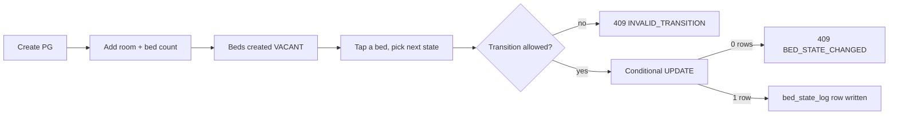

# Owner onboarding and bed grid

- **Shipped:** 2026-09-22
- **Status:** shipped (no auth yet)
- **Related:** ADR-002 (bed availability is a state machine), ADR-005 (JdbcClient over JPA)

## Why

An owner must be able to put a PG into the system and keep its beds accurate in seconds, on a phone. Accurate beds are the product; everything the seeker sees depends on this screen being true.

## How it works

Adding a room of N sharing creates N beds labelled A, B, C… all VACANT. Every state change goes through `BedService.changeState`, which checks the transition table in `BedState`, then performs a conditional update guarded on the current state. A losing race returns 409 rather than silently overwriting. `ON_NOTICE` requires an `availableFrom` date, which is what later makes a bed bookable in advance.

## API

| Method | Path | Auth | Purpose |
| --- | --- | --- | --- |
| POST | /api/dev/owners | none (temporary) | Create an owner without login |
| POST | /api/pgs | X-Owner-Id header | Create a PG (DRAFT) |
| GET | /api/pgs | X-Owner-Id header | List the owner's PGs with vacant/total counts |
| GET | /api/pgs/{id} | none | PG plus its full bed grid |
| POST | /api/pgs/{id}/rooms | none | Add a room and its beds |
| PATCH | /api/pgs/{id}/status | none | DRAFT / LIVE / PAUSED / REMOVED |
| GET | /api/pgs/{id}/beds | none | Bed grid alone |
| PATCH | /api/beds/{id}/state | X-Owner-Id header (actor) | Change one bed's state |
| GET | /api/beds/{id}/history | none | Audit trail for a bed |

Error codes: `INVALID_TRANSITION`, `BED_STATE_CHANGED`, `AVAILABLE_FROM_REQUIRED`, `BED_NOT_FOUND`, `PG_NOT_FOUND`, `VALIDATION_FAILED`.

## Data

Writes `pg_property`, `room`, `bed`, `bed_state_log`, and `app_user` (dev endpoint). No migration added; V1 covers it. Location is stored as `geography(point,4326)` via `ST_MakePoint(lng, lat)` — note the longitude-first argument order.

## Screens

Owner page: create PG form, PG list with vacant/total, room form, bed grid coloured by state with one-tap actions, listing status toggle. Empty state when no PGs or no rooms; errors surface inline and trigger a re-read so the grid never shows a stale bed.

## Config

None. `X-Owner-Id` is a temporary header, replaced by the JWT when phone OTP login ships.

## Tests

`BedStateMachineTest`: legal transition writes an audit row; illegal transition rejected; ON_NOTICE requires and stores a date.
`BedHoldConcurrencyTest`: **must never be deleted** — 50 threads race for one bed, exactly one wins, exactly one audit row.
`ApiApplicationTests`: migrations applied, 11+ tables.

## Known gaps

- No authentication: anyone who knows an owner id can edit that owner's PGs. Next feature.
- No photos or video upload yet, so listings cannot go LIVE for seekers in a meaningful way.
- HELD is currently set by the owner by hand; the seeker-driven hold with expiry arrives with booking.
- No ownership check that the PG belongs to the caller — lands with auth.
