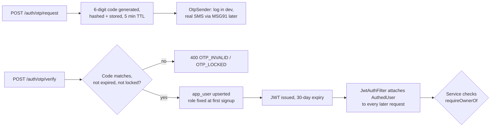

# Phone OTP login

- **Shipped:** 2026-09-23
- **Status:** shipped (real SMS delivery not yet configured — see Known gaps)
- **Related:** none yet (no ADR: this implements an architecture decision already made in CLAUDE.md, not a new one)

## Why

Every write in the API trusted a client-supplied `X-Owner-Id` header — anyone who knew or guessed
an owner id could edit that owner's PGs and beds. This replaces that with real phone-number login:
an owner (or, later, a seeker) proves they hold a phone number via a one-time code, gets a signed
token, and every write is checked against who that token actually belongs to.

## How it works

`POST /auth/otp/request` generates a 6-digit code, stores `SHA-256(phone:code)` with a 5-minute
expiry, and hands it to whichever `OtpSender` is active (see Config). `POST /auth/otp/verify`
checks the newest unconsumed, unexpired code for that phone: wrong guesses increment an attempt
counter and lock the code after 5; a correct one upserts `app_user` (creating it only if the phone
has never logged in before) and issues a JWT. `JwtAuthFilter` runs on every request, and — if a
valid `Authorization: Bearer` token is present — attaches the decoded identity as a request
attribute; it never rejects a request itself, since several endpoints (PG detail, bed grid, media
list) stay public. Each write endpoint reads that attribute via `@RequestAttribute` and calls
`AuthedUser.require` (401 if signed out) and `.requireOwnerOf(pgOwnerId)` (403 if signed in as
someone else) before touching data. A phone number's role is fixed the first time it ever logs in
and never changes on a later login request, even if that request claims a different role — closing
the obvious role-escalation path where re-logging in as SEEKER could otherwise be used to smuggle
seeker access onto an existing owner account, or vice versa.

## API

| Method | Path | Auth | Purpose |
| --- | --- | --- | --- |
| POST | /api/auth/otp/request | none | Send (or log, in dev) a 6-digit code to a phone number |
| POST | /api/auth/otp/verify | none | Exchange phone + code for a JWT |
| GET | /api/auth/me | bearer | Who the current token belongs to |
| POST | /api/pgs | bearer, OWNER | Create a PG (ownerId now comes from the token, not a request field) |
| GET | /api/pgs | bearer, OWNER | List only the caller's own PGs |
| POST | /api/pgs/{pgId}/rooms | bearer, owner of that PG | Add a room |
| PATCH | /api/pgs/{pgId}/status | bearer, owner of that PG | Change listing status |
| PATCH | /api/beds/{bedId}/state | bearer, owner of that bed's PG | Change a bed's state (actor is now the token's user, not a header) |
| POST/PATCH/DELETE | /api/pgs/{pgId}/media/... | bearer, owner of that PG | All media writes now ownership-checked (previously none were) |

Full request/response shapes are in the generated [API reference](../api/index.md). Notes the spec
can't express: `otp/request`'s `role` field is only used the first time a phone number ever logs
in — every later login for that phone ignores whatever role is sent and keeps the role the account
was created with; a new phone number omitting `role` gets `ROLE_REQUIRED`. `GET /pgs/{pgId}` (PG
detail), `GET /pgs/{pgId}/beds` (bed grid) and `GET /pgs/{pgId}/media` stay public/unauthenticated —
only writes are ownership-gated in this change; a public seeker-facing detail view is backlog item 2.

Error codes added: `UNAUTHENTICATED`, `OWNER_ONLY`, `NOT_YOUR_PG`, `INVALID_PHONE`, `ROLE_REQUIRED`,
`OTP_RATE_LIMITED`, `OTP_NOT_FOUND`, `OTP_LOCKED`, `OTP_INVALID`, `OTP_SEND_FAILED`.

## Data

New table `otp_request` (V3 migration): `phone`, `code_hash`, `role`, `expires_at`, `consumed_at`,
`attempts`, indexed on `(phone, created_at desc)` for both the "latest active code" lookup and the
hourly rate-limit count. No change to `app_user` — its existing `role` check constraint
(`OWNER`/`SEEKER`/`ADMIN`) already covered what login needed.

## Screens

Owner app: `OwnerPage` now renders `LoginPage` (phone entry → code entry, two simple forms) instead
of the old "Create a test owner" button when no token is present. Header gains the signed-in phone
number and a Sign out button. No other screen changed visually; they just now send a bearer token
instead of an `X-Owner-Id` header, and a 401 anywhere sends the owner back to `LoginPage`.

## Background jobs

None. (Expired OTP rows are simply never matched by `latestActiveOtp`'s `expires_at > now()` check;
there's no cleanup job for old rows yet — harmless clutter, not a correctness issue, worth a cheap
`delete where expires_at < now() - interval '1 day'` job later if the table ever gets large.)

## Config

| Key name | Where it lives | Required |
| --- | --- | --- |
| AUTH_JWT_SECRET | server env (`auth.jwt-secret`) | Dev default provided; **any real deploy must set a real random 32+ byte value** |
| OTP_PROVIDER | server env (`otp.provider`) | No — defaults to `log` (prints the code to the server log) |
| MSG91_AUTH_KEY | server env (`otp.msg91.auth-key`) | Only if `OTP_PROVIDER=msg91` |
| MSG91_TEMPLATE_ID | server env (`otp.msg91.template-id`) | Only if `OTP_PROVIDER=msg91` |

Never the value. `OtpSender` is an interface; `LoggingOtpSender` (active by default) and
`Msg91OtpSender` (active only when `OTP_PROVIDER=msg91`) are swappable implementations, so adding a
second SMS provider later needs no change to `OtpService`.

## Tests

`JwtServiceTest` (pure, no Spring/DB): issue→parse round-trips the right identity; a token signed
with a different secret, a tampered token, and garbage input all fail to parse; a too-short secret
refuses to construct the service at all.

`OtpServiceTest` (Testcontainers Postgres, service built by hand so a fake `OtpSender` can capture
the code instead of logging it): a new number signs up with the role it requested; **an existing
user's role can never be changed by a later login request claiming a different role**; a brand-new
number with no role is rejected; a wrong code is rejected and the right one still works afterward;
a code cannot be reused; 5 wrong attempts locks the code even against the correct guess; a 6th
request in the rate-limit window is rejected; an invalid phone number is rejected before anything
is sent.

`PgOwnershipTest` (Testcontainers Postgres): an owner's PG list never includes another owner's PG;
an owner cannot add a room to or change the status of another owner's PG; a seeker cannot create a
PG; an unauthenticated caller is rejected outright; the rightful owner can still edit their own PG.
This is the direct proof of the backlog's "an owner can only see and edit their own PGs" line.

`BedStateMachineTest`, `BedHoldConcurrencyTest` and `MediaServiceTest` were updated to pass an
owning `AuthedUser` through the new signatures — their actual assertions (state machine rules, the
50-thread race, cover/reorder/delete behaviour) are unchanged. **`BedHoldConcurrencyTest` still
must never be deleted or weakened.**

## Known gaps

- **No real SMS provider is configured or has been tested against a live account.** `Msg91OtpSender`
  exists but has never sent a real message — see its class-level Javadoc for the manual setup
  (MSG91 account, TRAI/DLT template registration, real auth key, a live phone test) that has to
  happen before `OTP_PROVIDER=msg91` can be turned on anywhere.
- No refresh token: a JWT is valid for 30 days flat; logging in again is the only way to get a new
  one. Acceptable for v1, worth revisiting before real scale.
- No admin login path (`Role.ADMIN` exists in the schema but nothing issues a token for it).
- `GET /pgs/{pgId}` and `GET /pgs/{pgId}/beds` stay fully public — fine today since nothing is
  deployed, but seeker-facing search (backlog item 2) needs to decide what a DRAFT/PAUSED PG should
  return to a stranger.
- No rate limiting on `/auth/otp/verify` guess attempts *across* different OTP requests for the same
  phone — a caller who requests a fresh code after locking one out gets 5 fresh attempts. The
  request-side rate limit (5/hour) bounds how often that reset can happen.
