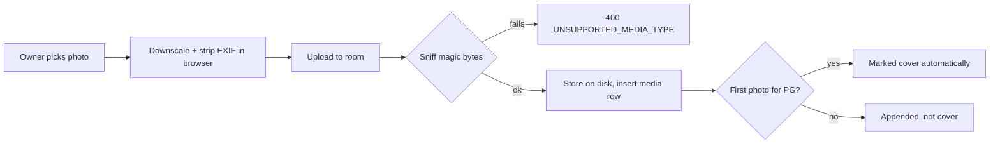

# Photos and video per PG

- **Shipped:** 2026-09-23
- **Status:** shipped (no auth yet)
- **Related:** ADR-005 (JdbcClient over JPA)

## Why

A listing with no real photos is worthless to a seeker, and a bait-and-switch photo is one of the
named reasons tenants distrust PG listings today. An owner must be able to add real room photos
and one walkthrough video from a phone, in seconds, with no way to upload something that isn't
actually a photo or video.

## How it works

Photos are scoped to a room (max 10), the video is scoped to the whole PG (max 1). A browser-side
canvas re-encode downscales photos to a 1600px edge and drops EXIF (so a phone's GPS coordinates
never leave the device) before upload; a video is checked for size (50MB) and duration (60s) client-side
first, then re-checked server-side since the client check is not trustworthy. The server never
trusts a client-supplied filename or `Content-Type` — every upload is identified by its magic bytes
(`ContentSniffer`) and rejected if the bytes don't match the accepted photo/video types. A second
video upload deletes the first (one video per PG, enforced by a partial unique index, not just
application logic). Every accepted MP4 is re-parsed to read its true duration and to zero out the
`moov/udta` and `moov/meta` boxes in place — phones write GPS coordinates there — without moving any
bytes, because shifting bytes after `moov` would invalidate the absolute chunk offsets in a
faststart file and silently break playback. Deleting the cover photo promotes the next photo by
sort order automatically, so a listing is never left without one. File deletes on disk only run
after the owning transaction commits, and are best-effort/logged-only if they fail — the DB row is
already the source of truth either way.

## API

| Method | Path | Auth | Purpose |
| --- | --- | --- | --- |
| GET | /api/pgs/{pgId}/media | none | List all photos + video for a PG |
| POST | /api/pgs/{pgId}/rooms/{roomId}/media/photos | X-Owner-Id | Upload one photo to a room (max 10/room) |
| POST | /api/pgs/{pgId}/media/video | X-Owner-Id | Upload the PG's one walkthrough video, replacing any existing one |
| PATCH | /api/pgs/{pgId}/media/{mediaId}/cover | X-Owner-Id | Set a photo as the PG's cover |
| PATCH | /api/pgs/{pgId}/rooms/{roomId}/media/reorder | X-Owner-Id | Rewrite photo sort order for a room; rejected if the id set is stale |
| DELETE | /api/media/{mediaId} | X-Owner-Id | Delete a photo or video |

Full request/response shapes are in the generated [API reference](../api/index.md). Notes the spec
can't express: `uploadPhoto` auto-marks the first photo in a PG as cover; `uploadVideo` silently
replaces any existing video (delete-then-insert inside the same transaction, guarded by the
`media_one_video_per_pg` partial unique index); `reorder` is rejected with `REORDER_MISMATCH` if the
id set sent doesn't exactly match what's currently in that room (stale client state); `delete` of the
cover photo promotes the next photo by sort order, never leaving a PG with photos and no cover.

Error codes: `FILE_MISSING`, `FILE_UNREADABLE`, `UNSUPPORTED_MEDIA_TYPE`, `PHOTO_LIMIT_REACHED`,
`VIDEO_TOO_LARGE`, `UNSUPPORTED_VIDEO_FORMAT`, `VIDEO_TOO_LONG`, `REORDER_MISMATCH`,
`ROOM_NOT_FOUND`, `MEDIA_NOT_FOUND`.

## Data

Writes `media` (from V1, extended by V2 with `is_cover` and `created_at`). Two partial unique
indexes from V2: `media_one_cover_per_pg` (`kind = 'PHOTO' and is_cover`) and `media_one_video_per_pg`
(`kind = 'VIDEO'`) — the database enforces "at most one" rather than relying on service-layer
discipline alone. `media.url` actually stores a storage key, not a servable URL; `MediaStorage`
turns a key into a URL at read time, which is what will let the storage backend switch from local
disk to R2 later without a data migration.

## Screens

Owner page → PG detail → `MediaManager`: one photo strip per room (upload input, drag-free
left/right reorder buttons, per-photo cover/delete, upload progress, 10-photo counter) plus one
video slot (upload, inline `<video>` preview, delete, replace-confirmation dialog). Empty states:
"Add a room first" when a PG has no rooms yet; "No photos yet" per empty room; "No video yet" with
a one-line prompt to film one take gate-to-room. Errors surface inline per photo-strip/video-slot
and don't block the rest of the manager.

## Background jobs

None.

## Config

| Key name | Where it lives | Required |
| --- | --- | --- |
| MEDIA_ROOT | server env (`media.root` property, defaults to `./data/media` in dev) | no |

Never the value. `LocalDiskMediaStorage` serves files back under `/media/**`; swapping in an
R2-backed `MediaStorage` implementation needs no change to `MediaService`, `MediaController` or the
`media` table.

## Tests

`Mp4ProcessorTest` (pure byte-level, no Spring/DB): strips `moov/udta` GPS metadata without moving
any bytes, leaves a file with no metadata box unchanged, rejects unparseable input rather than
storing it as-is.

`MediaServiceTest` (Testcontainers Postgres): first photo auto-becomes cover; deleting the cover
promotes the next photo — **a listing must never be left without a cover**; an 11th photo in one
room is rejected; a file that doesn't sniff as an accepted type is rejected; a video uploaded as a
photo is rejected; reorder rewrites sort order and rejects a stale id list; a second video upload
replaces the first; a video over 60s is rejected.

## Known gaps

- No ownership check beyond `X-Owner-Id` — same gap as the rest of the API until phone OTP login
  (backlog item 2) lands.
- No DigiLocker KYC, no WhatsApp complaint tickets, no AI-assisted listing generation from
  caretaker photos — all explicitly deferred per the PGStack MVP scope ("nice to have" / "do not
  build yet").
- No native-app camera integration; upload uses a plain `<input type="file" capture="environment">`.
- Video duration/size limits are also checked client-side for a fast UI rejection, but the server
  check is the one that matters — the client check is a courtesy, not a security boundary.
