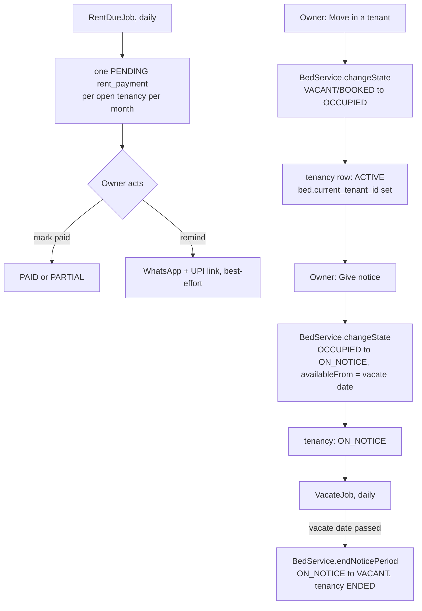

# Rent register and notices

- **Shipped:** 2026-09-23
- **Status:** shipped (WhatsApp delivery not yet configured — see Known gaps)
- **Related:** none new

## Why

This is the reason an owner opens the app every day instead of a notebook: move a tenant in, watch
this month's rent go from PENDING to PAID with one tap, and give notice without a second step to
remember to free the bed later. Everything here is built to keep `bed.state` the single source of
truth — a tenancy is never allowed to exist without the bed reflecting it, and vice versa.

## How it works

Moving in a tenant and giving notice both go through the *same* owner-gated
`BedService.changeState` the bed grid already used — `TenancyService` doesn't duplicate the state
machine, it just also writes the tenancy row in the same transaction. Because the bed and tenancy
writes share one `@Transactional` method, they can't drift apart: an OCCUPIED bed with no tenancy,
or a tenancy pointing at a bed that isn't OCCUPIED, is not a state this code can reach. Giving
notice sets `available_from` on the bed in the exact same call that starts the notice period — the
domain rule from CLAUDE.md ("automatic, never a separate owner action") falls out of reusing
`changeState` rather than needing its own logic.

`RentDueJob` (daily) gives every currently open (`ACTIVE` or `ON_NOTICE`) tenancy a `PENDING` row
for the current month if it doesn't have one yet — idempotent, safe to run more than once a month.
`VacateJob` (daily) is `booking.HoldExpiryJob`'s sibling: it finds tenancies whose `vacate_date` has
passed, calls the new `BedService.endNoticePeriod` (identical logic to `releaseHold`, kept as a
separate method purely so the caller's name says what actually happened), clears
`bed.current_tenant_id`, and ends the tenancy — skipping gracefully, never crashing the sweep, if
the bed already moved on some other way in between.

## API

| Method | Path | Auth | Purpose |
| --- | --- | --- | --- |
| POST | /api/tenancies | bearer, owner of that bed's PG | Move a tenant in (bed → OCCUPIED) |
| PATCH | /api/tenancies/{id}/notice | bearer, owner of that tenancy's PG | Give notice (bed → ON_NOTICE, availableFrom set) |
| GET | /api/pgs/{pgId}/tenancies | bearer, owner of that PG | All tenancies for a PG |
| GET | /api/pgs/{pgId}/rent | bearer, owner of that PG | All rent payments for a PG |
| PATCH | /api/rent/{id}/paid | bearer, owner of that payment's PG | Mark paid (full or partial) |
| POST | /api/rent/{id}/remind | bearer, owner of that payment's PG | Send a WhatsApp reminder |
| PATCH | /api/pgs/{pgId}/upi | bearer, owner of that PG | Set the UPI id reminders link to |

Full request/response shapes are in the generated [API reference](../api/index.md). Notes the spec
can't express: a tenant phone that has never logged in is registered as a `SEEKER` on the spot, and
an existing account's role is never changed by this call (same non-escalation principle as OTP
login); `POST /tenancies` fails with the ordinary `INVALID_TRANSITION` if the bed isn't currently
VACANT or BOOKED; `PATCH /notice` fails with `TENANCY_NOT_ACTIVE` if notice was already given;
`markPaid` with no `amount` marks the full amount paid, a smaller `amount` marks it `PARTIAL`.

Error codes added: `TENANCY_NOT_FOUND`, `TENANCY_NOT_ACTIVE`, `PAYMENT_NOT_FOUND`.

## Data

No migration for `tenancy`/`rent_payment` — every column this feature needs was already in V1.
**V4** adds one nullable column: `pg_property.upi_vpa`, the owner's UPI collection id for rent
reminders. `bed.current_tenant_id` (also already in V1, never written to before this feature) is
now kept in sync: set on move-in, cleared when the vacate sweep runs.

## Screens

Owner PG detail gains two things:

- **Tenants & rent** card: one row per open tenancy (bed, tenant, rent, due day, ACTIVE/ON_NOTICE),
  the current month's payment status inline with Mark paid / Remind buttons once it exists, a Give
  notice button per active tenancy, and a "+ Move in a tenant" form (bed picker limited to
  VACANT/BOOKED beds, tenant phone/name, move-in date, rent, due day).
- A small **UPI id** field near the listing-status toggle, so reminders can carry a real payment
  link.

`BedGrid`'s quick-action buttons no longer offer OCCUPIED (from VACANT/BOOKED) or ON_NOTICE (from
OCCUPIED) directly — those bypassed tenancy tracking entirely before this feature existed. A muted
hint points to the new section instead. The plain state-change escape hatches that don't need a
tenancy (BOOKED/OCCUPIED → VACANT, ON_NOTICE → VACANT/OCCUPIED) are untouched.

## Background jobs

- `RentDueJob`, daily: one PENDING rent row per open tenancy per month.
- `VacateJob`, daily: ends a tenancy and frees its bed once the notice period is over.

Both log and continue rather than crash the scheduler thread on failure, same as `HoldExpiryJob`.

## Config

None new — `upi_vpa` is data (per PG, settable in the UI), not server config.

## Tests

`TenancyServiceTest` (Testcontainers Postgres) — **the required notice → ON_NOTICE → VACANT
transition test**, plus: moving in a tenant occupies the bed and sets `current_tenant_id`; a custom
rent due day is kept, otherwise it defaults to the 5th; moving a tenant onto an already-occupied bed
is rejected (the ordinary state-machine guard, not new logic); a different owner cannot move in a
tenant or give notice; giving notice sets `ON_NOTICE` with `available_from` in the same call; notice
cannot be given twice; the vacate sweep frees a bed whose notice period ended and marks the tenancy
`ENDED`; the sweep leaves a tenancy alone before its vacate date; the sweep never touches a tenancy
that was never given notice.

`RentServiceTest` (Testcontainers Postgres): the due sweep creates exactly one pending payment per
open tenancy for the current month; running it twice in the same month does not duplicate; marking
a payment paid in full sets `PAID`; a smaller amount sets `PARTIAL`; a different owner can neither
see nor mark another owner's rent; sending a reminder does not throw even with no UPI id set.

## Known gaps

- **No real WhatsApp delivery** — same `notify.LoggingWhatsAppSender` as visit booking; see that
  feature's Known gaps for what a real sender needs.
- No editing or deleting a tenancy once created (e.g. a typo'd rent amount or due day) — fixing one
  today means ending the tenancy and creating it again, which also churns the bed through
  OCCUPIED→VACANT→OCCUPIED. Worth a dedicated edit endpoint if this comes up in practice.
- No partial-payment history — `rent_payment` holds one row per month with one `amount`, so a
  tenant paying in two installments overwrites the first `PARTIAL` amount rather than accumulating
  them. Matches the schema as given in V1; a real ledger would need its own table.
- No back-fill for beds that were already OCCUPIED before this feature shipped (there are none —
  this is pre-launch data) or for one moved to OCCUPIED some other way — such a bed has no tenancy
  and will not appear in the rent register until manually corrected.
