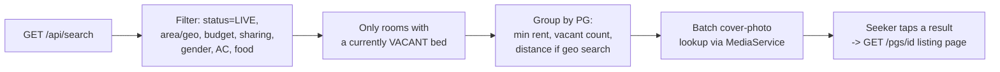

# Seeker search

- **Shipped:** 2026-09-23
- **Status:** shipped
- **Related:** none new (uses the existing PostGIS `location` column and bed/media conventions)

## Why

A stranger with no account must be able to find a real PG near a landmark on their phone. Search
is the first thing a seeker touches, and it has to reflect the same live bed state the owner just
saw on their bed grid — no caching, no separate "listing" snapshot that can drift from reality.

## How it works

`SearchRepository` runs one query joining `pg_property`, `room` and `bed`: every filter (area text,
lat/lng + radius via `ST_DWithin`, budget, sharing type, AC, food, gender) narrows which
`room`/`bed` rows count, then the results are grouped per PG. `min_rent_per_bed` and the vacant bed
count both use a Postgres `FILTER (WHERE b.state = 'VACANT')` on the aggregate, not just a
`HAVING` at the end — so a PG never advertises a "from ₹X" price for a room type that's actually
fully booked. A gender filter (`BOYS`/`GIRLS`/`WORKING_WOMEN`) also matches `UNISEX` PGs, since a
unisex option is always valid for that seeker too. Cover photo URLs are fetched in one batched call
to `MediaService.coverPhotoUrls`, not per-result, so the search package never has to know about
storage keys or the media table directly. With `lat`/`lng`, results are ordered by distance and a
missing `radiusKm` defaults to 5 km; without coordinates, `distanceKm` is `null` and results are
ordered by area then name.

## API

| Method | Path | Auth | Purpose |
| --- | --- | --- | --- |
| GET | /api/search | none | Search LIVE PGs with at least one vacant, filter-matching bed |

Query params, all optional: `area` (substring, case-insensitive), `lat`+`lng`+`radiusKm` (radius
defaults to 5 km if coordinates are given and radius is not), `minRent`, `maxRent`, `sharingType`
(`SINGLE`/`DOUBLE`/`TRIPLE`/`FOUR_PLUS`), `genderType` (`BOYS`/`GIRLS`/`UNISEX`/`WORKING_WOMEN`),
`ac`, `foodIncluded`. Response is a flat array, no pagination yet (fine at the launch-gate scale of
25+ PGs in one area; revisit once a search can return hundreds of results).

Full request/response shapes are in the generated [API reference](../api/index.md).

Also changed: `GET /api/pgs` and `GET /api/pgs/{pgId}` (`PgView`, used by both the owner app and the
new seeker listing page) now also return `foodIncluded`, `foodType` and `noticePeriodDays` - these
were already captured by `POST /api/pgs` and stored, but no response ever returned them before this
change, so the listing page had nothing to show for "rules" beyond room/rent/photos.

## Data

Read-only: no migration. Reads `pg_property.location` (existing PostGIS `geography(point,4326)`
column, `ST_Distance`/`ST_DWithin`), `room`, `bed`, and — via `MediaService`, not directly — `media`.

## Screens

Two new seeker-facing screens (public, no login):

- `SearchPage` (`/search`): filter form (area, "search near me" via browser geolocation + radius
  select, budget, sharing, gender, AC, food) and a result grid (cover photo or a placeholder, name,
  area, "from ₹X/bed", vacant count, distance when searched by location). Empty state: "No PGs
  match yet. Try widening your filters."
- `ListingPage` (`/pgs/{id}`): photo strip, walkthrough video if present, a room-by-room rent/AC/
  vacancy breakdown, and a details section (food, notice period). Loading and error states (the
  error state links back to search rather than dead-ending).

Routing is a plain `window.location.pathname` switch in `App.tsx`, not a router library - see its
comment for the one-line justification (three screens, ordinary `<a>` navigation is enough for now).
`App.tsx` also gained a small nav with "Find a PG" / "Owner" links.

## Background jobs

None.

## Config

None new.

## Tests

`SearchServiceTest` (Testcontainers Postgres) - the required PostGIS-distance search filter test,
plus the rest of the filter surface: only `LIVE` PGs with a currently vacant, filter-matching bed
are returned (excludes `DRAFT` and fully-occupied PGs); a PG outside the search radius is excluded
and a nearby one is returned with `distanceKm < 1`; without coordinates `distanceKm` is `null` and
nothing is geographically excluded; a budget range only matches rooms in that range; the minimum
rent shown is scoped to rooms that still have a vacancy, not the PG's cheapest room overall; a
sharing-type filter excludes PGs with no matching vacant room; a gender filter also returns `UNISEX`
PGs; an area filter matches case-insensitively on part of the name.

## Known gaps

- No pagination - fine at current scale, not fine once search can return hundreds of PGs.
- `amenities`, `docs_required`, `meal_timings`, `lock_in_months`, `entry_close_time` and
  `visitors_allowed` all exist as columns on `pg_property` but nothing writes to them yet (no field
  for them on `CreatePgRequest`) - they were deliberately left out of this change rather than
  wiring up read support for columns that are always null today. The listing page's "Details"
  section will need them once an owner can actually set them.
- No result caps or query cost bound - at 25 PGs this doesn't matter; worth an `EXPLAIN` pass before
  the launch-gate scale (500+ beds) if search ever feels slow.
- Routing is a plain pathname switch (see Screens) - fine for three screens, will need a real
  approach once there are more.
