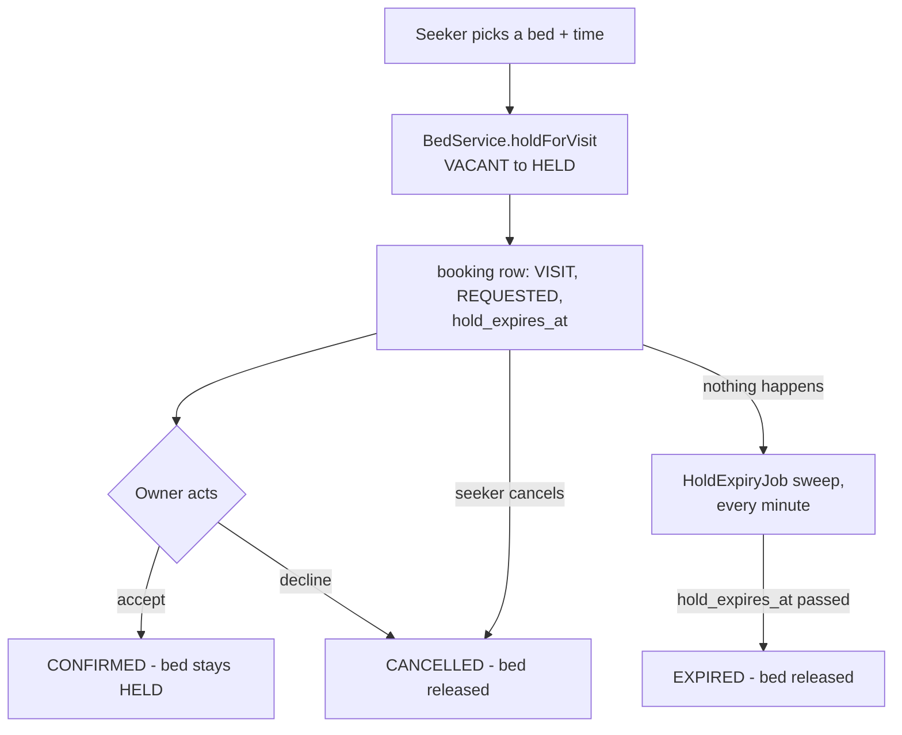

# Visit booking with holds

- **Shipped:** 2026-09-23
- **Status:** shipped (WhatsApp delivery not yet configured — see Known gaps)
- **Related:** none new

## Why

A seeker who finds a PG in search needs to actually get in front of it. Booking a visit slot holds
that specific bed so a second seeker doesn't turn up to view (or grab) the same one, and the hold
has to let go of itself if nobody follows through — a bed can never sit HELD forever just because
a seeker changed their mind and closed the tab.

## How it works

`BookingService.requestVisit` calls the exact same conditional VACANT-only update every other bed
transition uses (`BedService.holdForVisit`, which now shares its core logic with the owner-facing
`changeState` through a private `performTransition` helper) — so two seekers racing to hold one bed
is exactly as safe as two owners racing on the bed grid, and needs no new locking of its own. The
hold's length depends on how soon the visit is: a same-day visit gets a 2-hour hold, anything later
gets 24 hours (both compared in Asia/Kolkata, not UTC, so "same day" means what the seeker expects).
An owner accepting a request just moves the booking to `CONFIRMED` — the bed stays `HELD` either
way, since accepting only confirms the appointment, not a move-in. Declining or the seeker cancelling
both release the bed immediately rather than making anyone wait for the hold to time out on its own.
`HoldExpiryJob` (`@Scheduled(fixedDelay = 60_000)`, no queue, no broker — the `booking` table itself
is the only state that matters) sweeps every minute for bookings whose hold has passed and releases
them; if a bed already moved on some other way between the sweep's query and its release attempt
(the owner used the bed grid directly in between), that one row is skipped rather than crashing the
sweep — `BookingServiceTest` pins this exact case.

## API

| Method | Path | Auth | Purpose |
| --- | --- | --- | --- |
| POST | /api/bookings/visit | bearer, SEEKER | Hold a bed and request a visit slot |
| GET | /api/bookings/mine | bearer, SEEKER | The caller's own bookings |
| GET | /api/bookings/pg/{pgId} | bearer, owner of that PG | Open (REQUESTED/CONFIRMED) visit requests for one PG |
| PATCH | /api/bookings/{id}/accept | bearer, owner of that booking's PG | Confirm the appointment; bed stays HELD |
| PATCH | /api/bookings/{id}/decline | bearer, owner of that booking's PG | Cancel and release the bed immediately |
| DELETE | /api/bookings/{id} | bearer, the booking's own seeker | Cancel and release the bed immediately |

Full request/response shapes are in the generated [API reference](../api/index.md). Notes the spec
can't express: a new phone number's role is decided at OTP signup, not here, so only an existing
`SEEKER` account can call `requestVisit` — an `OWNER` token gets `SEEKER_ONLY`; a visit slot must be
in the future (`VISIT_SLOT_IN_PAST`); accepting only works on a `REQUESTED` booking, not one already
`CONFIRMED`/`CANCELLED`/`EXPIRED`; declining and cancelling both accept `REQUESTED` or `CONFIRMED`.

Error codes added: `SEEKER_ONLY`, `VISIT_SLOT_IN_PAST`, `BOOKING_NOT_FOUND`, `NOT_YOUR_BOOKING`,
`BOOKING_NOT_REQUESTED`, `BOOKING_NOT_OPEN`.

## Data

No migration — every column this feature needs (`kind`, `status`, `visit_slot`, `hold_expires_at`,
`token_amount`) was already in `booking` from V1. `token_amount` stays `0` for every `VISIT` booking;
this feature never touches payment, per CLAUDE.md.

## Screens

- **Listing page** (seeker, public but visit-booking requires sign-in): a "Want to visit?" card —
  signs the seeker in inline (reusing `LoginPage`, now parameterised by role instead of hardcoded to
  `OWNER`) if needed, then a bed picker + datetime-local input. Confirms with the hold's expiry time
  and a link to My bookings.
- **My bookings** (`/bookings`, seeker): every booking with a live countdown (ticking every 30s) to
  `hold_expires_at` while it's open, and a Cancel button.
- **Owner PG detail**: a new "Visit requests" card lists open requests for that PG (bed, seeker
  phone, visit time, status) with Accept/Decline buttons; empty and hidden entirely when there's
  nothing pending.

## Background jobs

`HoldExpiryJob`, every 60 seconds: releases any bed whose hold has passed `hold_expires_at` without
being accepted, declined or cancelled, and marks the booking `EXPIRED`. A failed sweep is caught and
logged, never left to crash the scheduler thread — it just tries again a minute later.

## Config

None new.

## Tests

`BookingServiceTest` (Testcontainers Postgres) — the required hold expiry job test, plus the rest of
the flow: requesting a visit holds the bed and creates a `REQUESTED` booking; a future visit gets a
24-hour hold and a same-day one gets 2 hours; a second seeker cannot also hold an already-held bed;
an owner cannot request a visit; a past visit slot is rejected; the owner can accept (booking
`CONFIRMED`, bed stays `HELD`); a different owner cannot accept or decline; declining releases the
bed and cancels the booking; a seeker can cancel their own booking and it releases the bed; a
different seeker cannot cancel someone else's booking; **the expiry sweep releases an overdue hold
and marks the booking `EXPIRED`**; the sweep leaves a not-yet-expired booking alone; the sweep skips
(without crashing) a booking whose bed was already moved on by some other path.

`BedService.changeState`'s existing behaviour is unchanged — it was refactored to share its
transition logic with the two new methods (`holdForVisit`, `releaseHold`) through a private helper,
not rewritten. `BedStateMachineTest` and `BedHoldConcurrencyTest` needed no changes and still pass
against the same public signature and the same ownership check.

## Known gaps

- **No real WhatsApp delivery.** `notify.WhatsAppSender` is an interface; `LoggingWhatsAppSender`
  (the only implementation so far) prints the message instead of sending it — same pattern as
  `auth.LoggingOtpSender`. A real Meta Cloud API sender needs a Business account, a verified number
  and template message approval, none of which can happen from code; it was deliberately not built
  this round rather than shipped unverified. Booking confirmations are visible only in the server
  log until that's done.
- Accepting a visit does not create a `RESERVE`/tenancy booking or move the bed toward `BOOKED` —
  that's intentional; nothing in the state machine currently converts "the visit happened" into "the
  seeker is moving in." The owner still moves the bed to `BOOKED`/`OCCUPIED` by hand via the bed grid
  once a seeker commits. Wiring that up is a job for the rent register/tenancy backlog items, not
  this one.
- No `NO_SHOW` handling — a booking that passes its visit time without anyone acting on it just rides
  out its hold and expires normally, same as any other unresolved request.
