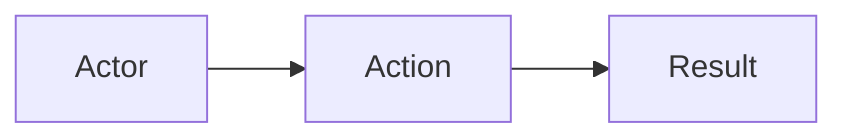

# <Feature name>

- **Shipped:** YYYY-MM-DD
- **Status:** shipped / partial / rolled back
- **Related:** ADR-00X, issue #N

## Why

One paragraph. The user problem, not the implementation.

## How it works

Three to six sentences on the flow. Name the states, jobs and edge cases.

## API

| Method | Path | Auth | Purpose |
| --- | --- | --- | --- |
| POST | /bookings/visit | seeker | Book a visit slot |

Full request/response shapes are in the generated [API reference](../api/index.md). Only document here what the generated spec cannot express: ordering, side effects, idempotency, timing.

## Data

Tables touched, new columns, migration number. Link to the generated schema page.

## Screens

Which screens changed, and the empty / loading / error states.

## Background jobs

Name, schedule, what it does, what happens if it does not run.

## Config

| Key name | Where it lives | Required |
| --- | --- | --- |
| WHATSAPP_TOKEN | GitHub Secrets → server env | yes |

Never the value. Names only.

## Tests

What is covered, and the one test that must never be deleted.

## Known gaps

What was deliberately left out, and when it becomes a problem.
