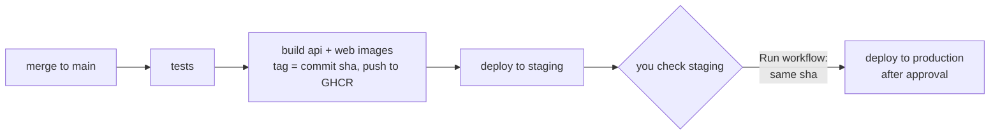

# Deployment

One Ubuntu VM per environment (staging, production) in an Indian region. Each runs the same Docker
Compose stack: Postgres+PostGIS, the API, and Caddy, which serves the web build, proxies `/api` and
`/media` to the API, and gets its own HTTPS certificate. No Kubernetes, no queue, no managed
Postgres. Files live in `deploy/`; the Dockerfiles are `api/Dockerfile` and `app/Dockerfile`.

## Release flow

1. **Merge to `main`** → `release.yml` runs the full backend test suite (Testcontainers, so real
   PostGIS), builds both images once, pushes them to GHCR tagged with the commit sha, and deploys
   that sha to **staging**.
2. **Production is promoted, never rebuilt.** Actions → *deploy* → *Run workflow* → environment
   `production`, the image repo (`ghcr.io/<your-user>`, lowercase) and a sha that has already run on
   staging. What you tested is byte-for-byte what goes live. The `production` environment should
   require your approval.
3. On the VM, `deploy.sh` pulls the images, restarts the stack, and waits up to 3 minutes for the
   API's health check (Flyway runs on boot, so a bad migration shows up here). If it never becomes
   healthy, the previous good release is put back automatically and the job fails.

This is a stop-then-start restart, not a zero-downtime swap: expect the site to be unavailable for
the seconds the API takes to boot, and for the full wait if a release fails. Acceptable at this
stage; revisit when someone notices.

PRs get `ci.yml`: backend tests, frontend build, and a syntax check of the deploy files.

## Rollback

Run *deploy* again with an **older sha** (any environment). That's the whole mechanism.

Never roll a migration back in production; write a forward migration. Keep migrations additive
(new nullable column, new table) so the previous release still runs against the newer schema —
that's what makes "redeploy the old sha" a safe rollback.

## First-time setup (once per VM)

Nothing below is automated on purpose; the scripts were not run against a real VM when written, so
treat the first run as a rehearsal and read the output.

1. **VM**: Ubuntu 22.04/24.04, public IP, in an Indian region. Copy this repo's `deploy/` to it and
   run `sudo ./bootstrap-vm.sh` (installs Docker, opens only 22/80/443/udp443, creates the `deploy`
   user, lays out `/srv/roomfinder`, installs the backup timers).
2. **DNS**: an `A` record for the environment's domain (`DOMAIN`) pointing at the VM. Caddy fetches
   the certificate itself on first start; ports 80 and 443 must be reachable for that.
3. **Secrets file**: create `/srv/roomfinder/.env` (owner `deploy`, `chmod 600`) with the keys listed
   under "production server only" in `.env.example`. `AUTH_JWT_SECRET`: `openssl rand -base64 48`.
   Compose refuses to start if `DB_PASSWORD`, `AUTH_JWT_SECRET`, `OTP_PROVIDER` or `DOMAIN` is
   missing, so a forgotten secret can't fall back to a dev default.
4. **SSH key for CI**: generate a key pair just for deploys, put the public half in
   `/home/deploy/.ssh/authorized_keys`, and the private half in the GitHub Environment (below).
5. **GitHub Environments** (Settings → Environments), one for `staging` and one for `production`,
   each with these secrets:

   | Secret | Value |
   | --- | --- |
   | `DEPLOY_HOST` | VM address |
   | `DEPLOY_USER` | `deploy` |
   | `DEPLOY_SSH_KEY` | private half of the deploy key |
   | `DEPLOY_KNOWN_HOSTS` | output of `ssh-keyscan <host>` — pins the host key instead of trusting whatever answers |

   Add required reviewers to `production`. No registry pull secret is stored: each deploy logs the
   VM in to GHCR with that run's own token. That works because the images are built with an
   `org.opencontainers.image.source` label, which links the new package to this repo; if the first
   pull is denied, check the package's *Manage Actions access* setting on GitHub.
6. **First deploy**: merge to `main` (staging) and watch the *release* run.

CI never holds application secrets: the DB password, JWT secret and SMS keys exist only in
`/srv/roomfinder/.env` on the VM. CI can restart the app; it can't read it.

## Backups

`roomfinder-backup.timer` runs `backup.sh` nightly at 02:30 IST: a `pg_dump` (checked with
`pg_restore --list`) uploaded to Cloudflare R2 under `<environment>/db/`, plus an incremental copy
of uploaded media under `<environment>/media/`. Dumps older than 30 days are deleted. Media is
*copied*, never synced, so deleting files on the VM can't propagate to the backup.

`roomfinder-restore-test.timer` runs `restore-test.sh` on the 1st of each month: it restores the
newest dump into a throwaway container and checks the schema history is intact. An untested backup
is not a backup — look at `journalctl -u roomfinder-restore-test` after it runs. Set
`BACKUP_PING_URL` (a dead-man's-switch service such as healthchecks.io) to be told if the nightly
backup ever silently stops.

Secrets (`.env`) are not backed up to R2. Keep a copy in a password manager. Losing
`AUTH_JWT_SECRET` only signs everyone out; losing `DB_PASSWORD` is recoverable from the volume.

## Docs site

Pushed on every merge that touches `docs/`, `mkdocs.yml` or `api/`, published to GitHub Pages
(`docs.yml`). Known problem: that workflow calls Gradle tasks (`generateOpenApiDocs`,
`flywayMigrate`) that `api/build.gradle` doesn't define, so it will fail until the OpenAPI and
Flyway Gradle plugins are added or the steps are changed.

## Not verified

Checked from a dev machine: the three workflows pass `actionlint`, `docker compose config` parses
and fails loudly on a missing secret, the Caddyfile validates and was run against a stub backend
(deep links fall back to the app, `/api` and `/media` reach the backend, `/actuator` and `/swagger`
are not exposed, cache headers are right), the shell scripts pass `bash -n`, and `npm ci` works
against the lockfile. **Never run:** the Docker image builds (no Docker daemon was available), the
scripts on a real VM, a real deploy, a real backup upload/restore, or the systemd timers. The
mobile wrapper is not part of this pipeline.
