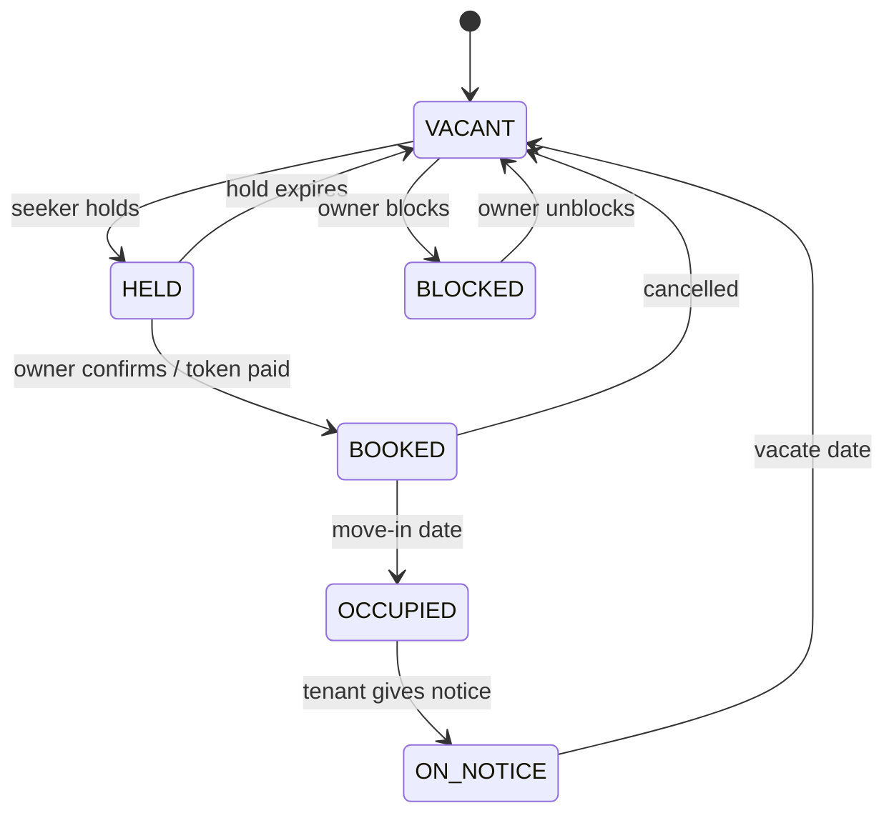

# Bed state machine

Invariants:

1. One active hold per bed, enforced by a partial unique index and a conditional update.
2. Every transition writes `bed_state_log` with actor and reason.
3. Holds expire by scheduled job, never by a human action.
4. `ON_NOTICE` beds are bookable with `available_from`.

The concurrency test (50 parallel holds on one bed, exactly one winner) must never be deleted.
